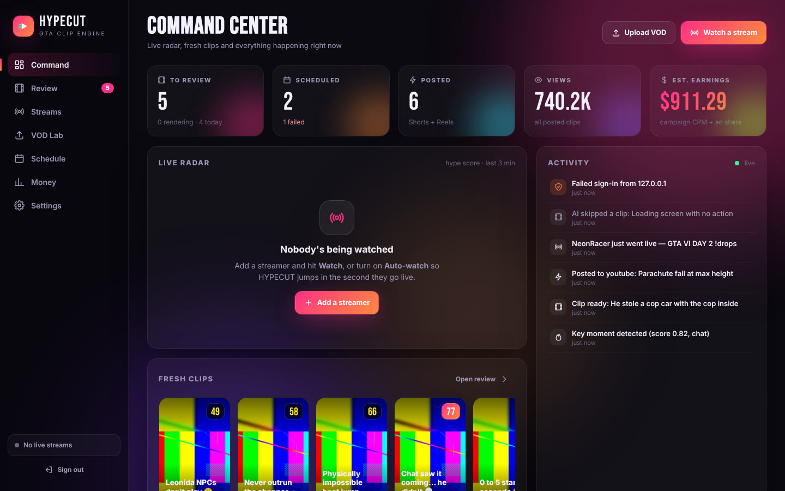
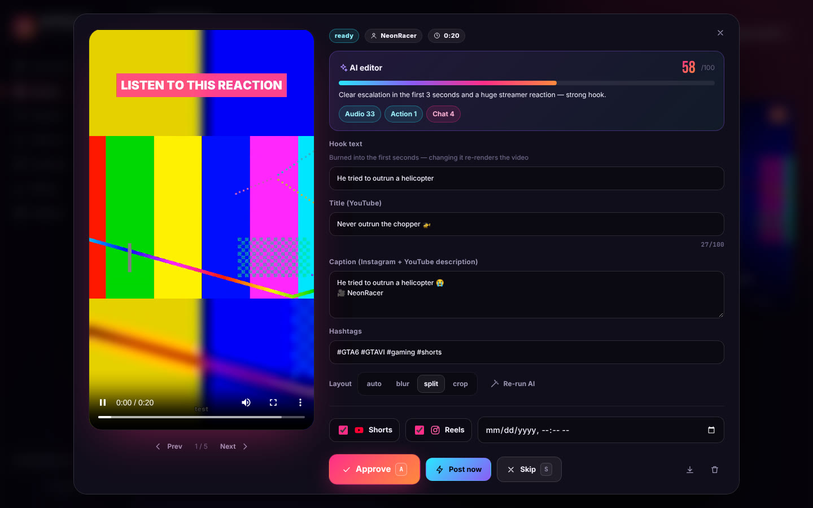
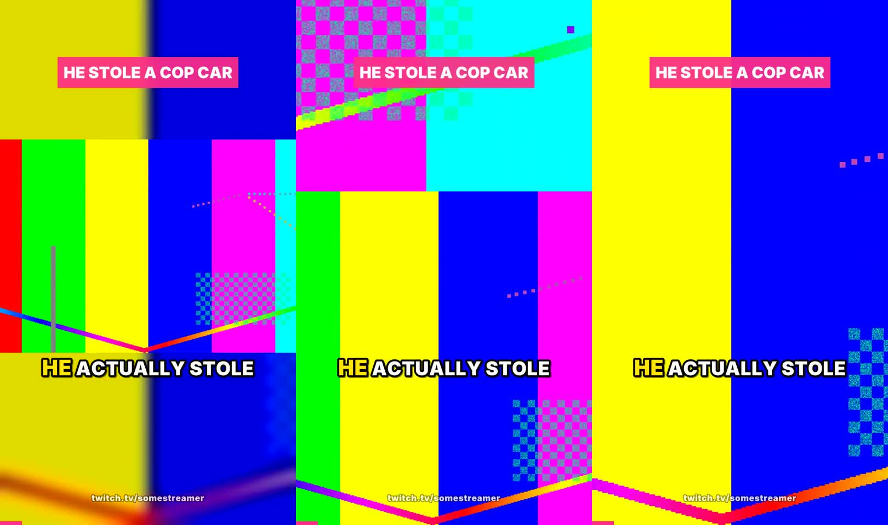

# HYPECUT — GTA clip engine

HYPECUT watches GTA live streams on Twitch, Kick and YouTube. It finds the key moments on its own, turns each one into a vertical Short with captions, and posts it to **YouTube Shorts** and **Instagram Reels**. You control it from a private dashboard that only you can sign in to.



```
Live stream ─▶ rolling buffer ─▶ moment detection ─▶ cut ─▶ AI editor ─▶ 9:16 render ─▶ review ─▶ schedule ─▶ YouTube + Instagram
                                      ▲                                                                              │
                                      └──────────────── view stats ─▶ auto-tune detection weights ◀─────────────────┘
```

## What it does

| | |
|---|---|
| **Live capture** | Pulls the stream with `streamlink` into a 15-minute rolling buffer of 4-second segments. With **Auto-watch** on, it checks each streamer every 2 minutes and starts capturing as soon as they go live. |
| **Moment detection** | Scores every second on five signals: **audio** spikes (screams, laughs, explosions), **action** (sudden motion), **chat** velocity weighted by hype words and emotes (Twitch, Kick and YouTube chat), **speech** hype phrases (Whisper) and **in-game banners** such as WASTED/BUSTED (OCR). Each signal is compared with that stream's own normal level. |
| **AI editor** | Claude looks at frames around the peak and reads the transcript. It skips weak clips and writes the hook, title, caption and hashtags, plus a virality score from 0 to 100. Without an API key it falls back to template copy. |
| **Vertical render** | 1080×1920 or 1440×2560 at up to 60 fps (the most Shorts and Reels accept), with optional sharpening and denoise. Four layouts: **split** (facecam on top, gameplay below), **blur** fill, **crop** (centred on where the action is) and **auto**. Burned-in word-by-word captions, a hook banner, a streamer credit, a progress bar, and audio normalised to −14 LUFS. |
| **Troll edit** | Claude plans a meme edit for each clip: zoom punch-ins, screen shake, flashes, one smooth slow-motion window, black-and-white "it all went wrong" moments, meme stickers, sound effects, short narrator lines and an ending card. Switch it on per clip (Review), per VOD (VOD Lab), per live streamer (Streams → **Live edit**) or as the default (Settings). |
| **Sounds and music** | 14 built-in sound effects and 6 built-in background beats (phonk, funny, suspense, epic, sad, chill), all generated by HYPECUT itself, so they're original and free. Add your own licensed sounds to `data/trollkit/sfx` and `data/trollkit/music`. With an ElevenLabs key, a narrator voice reads the troll lines. |
| **ElevenLabs credits** | **Credit saver** (on by default) spends credits only on the narrator voice, using the half-price Flash model. Each clip has a credit cap, a reserve is never spent, everything is cached, and the settings page shows your balance and roughly how many clips it covers. |
| **Review** | A grid of clips you swipe through. Press **A** to approve, **S** to skip, and use the arrow keys to move between clips. You can edit the hook, title and caption, switch layout, or re-run the AI. |
| **Scheduler** | Each approved clip takes the next free posting slot, one post per platform per slot. Failed uploads retry automatically. **Autopilot** can approve high-virality clips by itself. |
| **Publishing** | YouTube Data API v3 (resumable upload of the full-quality render) and Instagram Graph API (resumable Reels upload, no public URL needed). Instagram gets its own 1080×1920 copy made to its Reels spec, and a refused upload is retried with a fresh container. |
| **Money** | Views, estimated earnings per streamer and platform, which trigger types get the most views, and **auto-tune**, which re-weights detection based on your own view data. |
| **VOD Lab** | Drop in a past broadcast or paste a link (Twitch, YouTube, Kick, or anything yt-dlp can download). It finds the best moments and clips them. **Replay live** runs a file through the live pipeline, which is useful for testing. |

<p align="center"> </p>

## Quick start

You need Python 3.10+ and **ffmpeg** (built with libass, which is the default on most systems).

```bash
git clone <this repo> && cd GTA-5-Clips
python -m venv .venv && source .venv/bin/activate
pip install -r requirements.txt
pip install -r requirements-ml.txt   # optional: captions + speech signal (faster-whisper) and OCR
python -m gtaclips
```

Open **http://127.0.0.1:8000**. On first start the server console prints a **setup code**:

```
============================================================
  FIRST-RUN SETUP CODE:  7AAF-2D07-AA62
```

Enter that code and choose your password. Only someone who can see the server console can claim the install.

**Docker:**

```bash
docker compose up -d --build && docker compose logs | grep "SETUP CODE"
```

## Getting set up (about 10 minutes)

1. **Settings → AI editor**: paste an Anthropic API key from console.anthropic.com. Optional, but clip selection and hooks are much better with it.
2. **Settings → Accounts → YouTube**: create a Google Cloud OAuth client of type *Web application*, using the redirect URI the page shows you. Paste the client ID and secret, then click **Connect YouTube**.
3. **Settings → Accounts → Instagram**: you need an Instagram Creator or Business account linked to a Facebook Page, plus a Meta app with `instagram_content_publish`. Paste the IG user ID and a long-lived token, then click **Test connection**.
4. **Streams**: paste channel links. Turn on **Permission** for the streamers who have said yes, and **Auto-watch** for the ones you want clipped automatically. Click **Facecam** to draw the camera box used by the split layout.
5. **Settings → Schedule**: set your posting times and timezone.

Step-by-step instructions for each account are built into the Settings page.

## Making money with it

1. **Clipping campaigns**: streamers and brands pay per 1,000 views on clipping marketplaces. Add those streamers and enter their rate in "Pays per 1K views". The Money page tracks your estimated payout. This is the fastest way to start earning.
2. **Clipping for streamers directly**: charge a monthly fee or take a revenue share. The pitch: every stream becomes 10 Shorts by the next morning.
3. **Your own GTA VI channel**: approved clips plus strong hooks qualify for the YouTube Partner Program and grow Instagram reach.
4. **Selling the tool**: once it's proven, streamers can pay monthly to have their own streams clipped automatically.

> **Only post clips you have permission to post.** A stream belongs to the streamer. Reposting without permission gets copyright strikes, and raw re-uploads fail YouTube's reused-content review. HYPECUT holds every clip until you tick **Permission** for that streamer. It also credits the streamer on screen and in the caption, and adds real edits (hooks and captions) so the clips count as transformative.

## Keeping it private

- Listens on **127.0.0.1** only by default.
- There is one owner password, stored as a scrypt hash. Sessions are signed HttpOnly cookies, and changing the password signs out every other device.
- After 5 wrong passwords, that IP is locked out for 15 minutes. Every write request needs a CSRF header, and the server sends a strict Content-Security-Policy.
- API keys and tokens are stored on your machine (`data/`) and are never sent back to the browser.
- To use it from your phone, put it behind **Tailscale** or a **Cloudflare Tunnel** with HTTPS. Don't open a port to the internet.
- If you forget the password, run `python -m gtaclips set-password` on the machine.

## How detection works

For each signal, every second gets a rolling robust z-score against the previous 5 minutes, mapped to a 0–1 score. The signals are combined with a weighted *soft OR*: `hype = 1 − Π(1 − scoreᵢ · cᵢ)`. One strong signal is enough to trigger a clip, and so are several medium signals agreeing. A missing signal (no chat connection, no Whisper) doesn't drag the others down. A clip is cut from the peak minus the pre-roll and extended while the action continues (15–58 seconds). Chat is shifted back 4 seconds because viewers react after the moment. All of these settings are on **Settings → Detection**, and **Money → Auto-tune** adjusts the weights based on which triggers bring you the most views.

## Configuration

| Env var | Default | |
|---|---|---|
| `GTACLIPS_DATA` | `./data` | Database, buffers, clips, uploads, models |
| `GTACLIPS_HOST` | `127.0.0.1` | Bind address |
| `GTACLIPS_PORT` | `8000` | Port |

Everything else is set in the dashboard.

## Project layout

```
gtaclips/
  capture.py     streamlink → ffmpeg rolling segment buffer, live checks, VOD download, cutting
  chat.py        Twitch IRC, Kick Pusher, YouTube live chat listeners + hype weighting
  signals.py     per-second features, robust scoring, soft-OR combine, peak picking
  speech.py      faster-whisper word timestamps (optional)
  ai.py          Claude clip review → keep/skip, virality, hook, title, caption, hashtags
  render.py      9:16 layouts, karaoke ASS captions, hook, credit, progress bar, troll effects
  troll.py       Claude troll director: plan schema, validation, template plan, slow-mo time map
  trollkit.py    sound effects, ElevenLabs (voice/sfx/music) with credit budget, your sound library
  beats.py       built-in background beats synthesised with numpy (no samples)
  voice.py       Demucs: separate voices from game audio
  speaker.py     learns each streamer's voice so in-game dialogue is kept
  publishers.py  YouTube (OAuth + resumable upload + stats), Instagram (Reels + insights)
  engine.py      live workers, VOD jobs, render queue, scheduler, auto-watch, stats refresh
  analytics.py   earnings, views, per-signal performance, weight auto-tune
  server.py      FastAPI: owner-only API, SSE live feed, OAuth callback
  auth.py        scrypt password, signed sessions, lockout, signed media links
  static/        the dashboard (vanilla JS, no build step)
tests/           pytest suite (detection, parsing, auth, captions)
```

## Tests

```bash
pip install pytest && pytest -q
```

## Limits to know

- **YouTube quota**: one upload costs 1,600 units, so the default 10,000 units a day allows about 6 uploads. Request more in Google Cloud.
- **Instagram tokens** expire after 60 days, so refresh them in Settings.
- **CPU**: one live stream plus rendering runs fine on 4 cores. Live Whisper transcription for the speech signal works best with a GPU or the `tiny`/`base` model.
- Kick chat uses Kick's public web socket and may break if Kick changes it. YouTube live chat needs an API key and uses quota.
- TikTok is not supported yet. The publisher module is written so it can be added.
